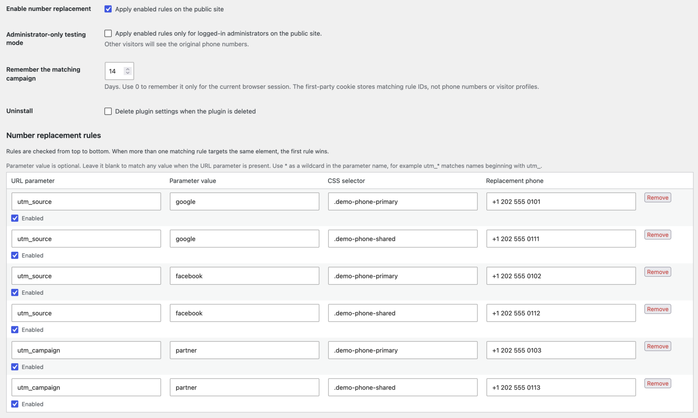
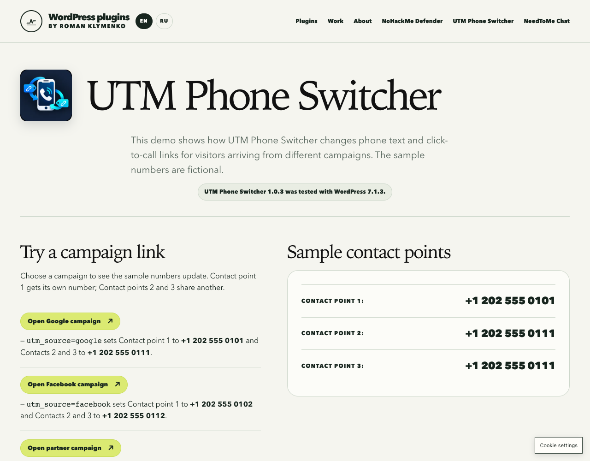
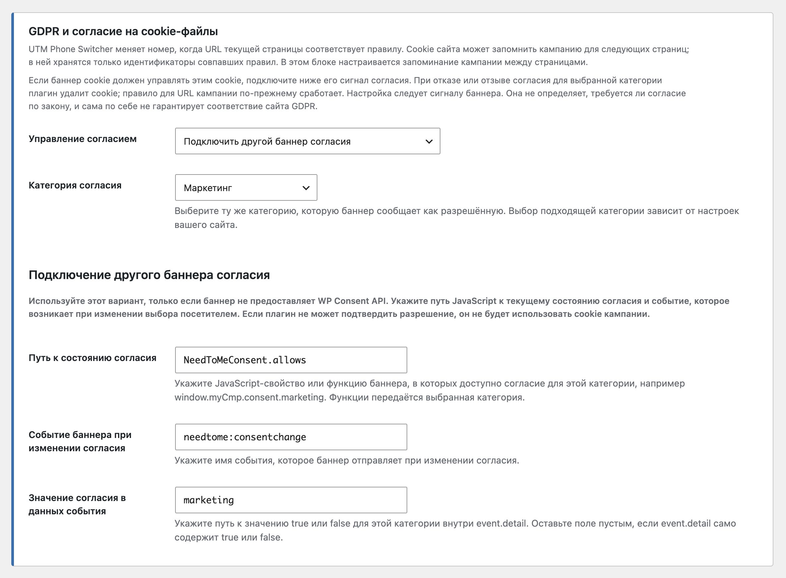

# UTM Phone Switcher

Show a campaign-specific phone number on a WordPress site by matching URL parameters. The plugin updates matching phone text and `tel:` links in the visitor's browser; it does not send campaign data to a third-party service.

[Live demo and plugin page](https://needtome.com/utm-phone-switcher/) · [Download the 1.0.4 WordPress.org review package](https://github.com/needtome/utm-phone-switcher/releases/download/v1.0.4/utm-phone-switcher-1.0.4.zip)

## Features

- Match any URL query parameter, including exact names and wildcard patterns such as `utm_*`.
- Match a parameter's presence or require an exact value.
- Target phone text with CSS selectors and update matching `tel:` links.
- Apply ordered rules to multiple contact points.
- Optionally remember matched rule IDs in a first-party cookie so the campaign number continues across pages.
- Connect campaign memory to the WordPress Consent API or a custom JavaScript consent state and change event. When consent is denied or withdrawn, the plugin clears and stops using the campaign cookie. The site owner chooses the consent category; the plugin does not classify cookies or certify legal compliance.
- Test enabled rules on the public site as a logged-in administrator before showing them to visitors.
- No call-tracking account or third-party service is required.

## Screenshots

### Campaign rules in the WordPress settings

### Campaign-specific phone numbers in the live demo

### Campaign memory and consent settings

## Requirements

- WordPress 6.3 or later
- PHP 7.4 or later
- Checked with WordPress 7.1.3

## Installation

1. Download the ZIP from the [v1.0.4 release](https://github.com/needtome/utm-phone-switcher/releases/tag/v1.0.4).
2. In WordPress, open **Plugins → Add Plugin → Upload Plugin**, choose the ZIP, and activate it.
3. Open **Settings → UTM Phone Switcher** and add a rule with a URL parameter, optional value, CSS selector, and replacement number.
4. Test a matching campaign URL, for example `https://example.com/contact/?utm_source=newsletter`.

## Developer

Roman Klymenko is a senior web developer with 15+ years in commercial development and 400+ delivered or optimized websites and platforms. His work focuses on high-performance WordPress, custom business systems, large catalogs, marketplaces, trading tools, automation, technical SEO, and integrations. He is also a published technical author, with production experience in JavaScript, Python/FastAPI, Node.js automation, Asterisk, parsers, bots, and performance engineering.

Custom website and WordPress plugin development is available at **$30/hour**. See [NeedToMe](https://needtome.com/) or the [developer profile](https://docs.google.com/document/d/11w_tmtQbJ7ebcQHQi7jE9Y5WClfVHyMtxbR3-GW3b-s/edit?tab=t.0).

Support continued plugin development via [DonationAlerts](https://www.donationalerts.com/r/needtome) or [Patreon](https://patreon.com/needtome).

## License

GPL-2.0-or-later. See [LICENSE](LICENSE).
